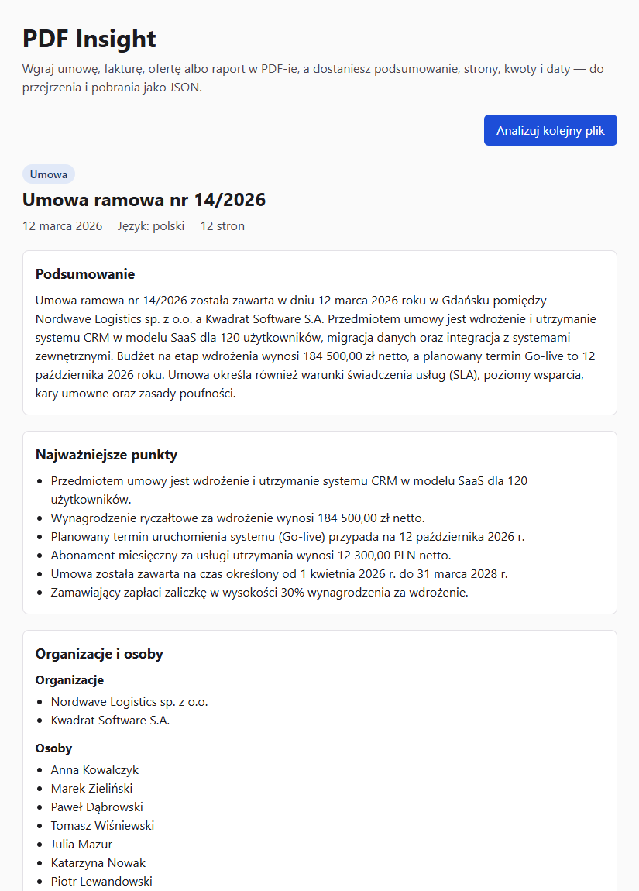

# PDF Insight

Aplikacja webowa, która przyjmuje PDF, tworzy jego krótkie podsumowanie i zamienia treść w uporządkowane dane do pobrania jako JSON.

**Demo:** https://callmemichal.github.io/pdf-insight/



Na zrzucie widać Wynik Analizy 12-stronicowej umowy testowej z zadania rekrutacyjnego (Analiza trwała około 14 s). Pod widocznym fragmentem są Kwoty, Wzmianki o dacie, słowa kluczowe, metadane, podgląd JSON-a z przyciskiem pobrania i Historia.

## Jak to działa

1. Użytkownik przeciąga PDF na stronę albo wybiera go z dysku. Przeglądarka sprawdza typ, rozmiar (do 10 MB) i liczbę plików.
2. pdf.js wyciąga tekst w przeglądarce. Plik PDF nigdzie nie jest wysyłany, idzie tylko tekst, nazwa pliku i liczba stron.
3. Cloudflare Worker sprawdza origin i dane wejściowe, potem limity Analiz na adres IP, i pyta Gemini o Wynik w trybie JSON ze schematem.
4. Worker waliduje odpowiedź schematem Zod. Jeśli jest niepoprawna, ponawia jeden raz, a potem zwraca błąd.
5. Strona waliduje Wynik ponownie i pokazuje go w sekcjach: podsumowanie, najważniejsze punkty, Organizacje i Osoby, Kwoty, Wzmianki o dacie, słowa kluczowe. Pełny JSON można podejrzeć i pobrać.
6. Wynik trafia do Historii w przeglądarce (ostatnie 10).

Terminy pisane wielką literą (Dokument, Analiza, Wynik, Kwota, Historia itd.) są zdefiniowane w [CONTEXT.md](CONTEXT.md).

## Architektura

```text
Przeglądarka (GitHub Pages)          Cloudflare Worker                     Google Gemini
React 19 + Vite, TypeScript strict   POST /analyze                         gemini-3.5-flash-lite
pdf.js: PDF → tekst          ──────▶ CORS, walidacja, limity na IP ──────▶ tryb JSON ze schematem
walidacja Wyniku (Zod)       ◀────── walidacja Wyniku (Zod), 1 ponowienie ◀──
Historia w localStorage              klucz API tylko w sekretach Workera
```

Repo to workspace npm z trzema pakietami:

| Katalog   | Zawartość                                                                                                                                |
| --------- | ---------------------------------------------------------------------------------------------------------------------------------------- |
| `shared/` | Schemat Zod Wyniku, typ TypeScript wyprowadzony ze schematu, stałe limitów i kody błędów API. Jedyne źródło prawdy dla Workera i strony. |
| `worker/` | Cloudflare Worker: handler `/analyze`, adapter Gemini za wąskim interfejsem, prompt, limity Analiz na IP.                                |
| `web/`    | Strona: `components/` (widoki), `lib/` (odczyt PDF-a, formatowanie, komunikaty, Historia), `api/` (klient Workera).                      |

CI/CD (`.github/workflows/ci.yml`): lint › typecheck › testy › build, a na `main` deploy strony na GitHub Pages i Workera przez `wrangler`.

## Najważniejsze decyzje

- **Tekst wyciągany w przeglądarce (pdf.js), nie na serwerze.** Do Workera idzie sam tekst, więc żądanie jest małe, limit 10 MB sprawdza przeglądarka, a liczba stron jest znana bez AI. Ceną jest brak OCR: skany nie mają warstwy tekstowej (patrz ograniczenia). Worker pdf.js jest ładowany przez `?url` w Vite, więc działa pod ścieżką `/pdf-insight/`.
- **Bez dzielenia na fragmenty.** Gemini ma okno kontekstu rzędu miliona tokenów, więc typowy dokument mieści się w jednym wywołaniu. Zamiast dzielenia tekstu i łączenia wyników (map-reduce) jest twardy limit 500 000 znaków tekstu (około 200 stron), sprawdzany w przeglądarce i w Workerze. Dłuższy dokument dostaje czytelny komunikat.
- **Najwyżej 60 Kwot i 40 Wzmianek o dacie.** Czas Analizy zależy od długości odpowiedzi modelu (około 500 tokenów na sekundę), a nie od rozmiaru pliku. Bez limitu PDF 9,9 MB z około 200 kwotami analizował się 23 s, a dokument z 490 tys. znaków przekraczał 25 s. Z limitem oba mieszczą się w 9–14 s. Prompt każe poniżej limitu wymienić wszystko, a powyżej najważniejsze najpierw. Nadmiar Worker przycina, zamiast ponawiać Próbę, która podwoiłaby czas.
- **Walidacja po obu stronach.** Worker nie odeśle Wyniku niezgodnego ze schematem (502), a strona odrzuca taką odpowiedź przed wyświetleniem i przy odczycie Historii. Oba miejsca używają tego samego schematu z `shared/`. Schemat odpowiedzi dla Gemini jest generowany z Zod, a reguł, których nie da się w nim wyrazić (np. poprawność daty w kalendarzu), pilnuje walidacja po odpowiedzi.
- **Metadane ustala Worker, nie model.** `fileName` i `pages` Worker bierze z żądania, a `meta` (`analyzedAt`, `model`, `schemaVersion`) dokłada sam. Model wypełnia tylko pola, które wymagają zrozumienia treści.
- **Daty z precyzją z Dokumentu.** Daty są w ISO 8601, ale tylko z taką dokładnością, jaką podaje Dokument: `YYYY-MM-DD`, `YYYY-MM` albo `YYYY` (zapis o zmniejszonej precyzji, dopuszczony przez ISO 8601). Model nie dopisuje brakującego dnia ani miesiąca, bo byłoby to zgadywanie. Waluty muszą być istniejącymi kodami ISO 4217, nie tylko trzema wielkimi literami.
- **Treść PDF-a to dane, nie polecenia.** Tekst Dokumentu jest w bloku z losowym znacznikiem przy każdej Próbie, a instrukcja systemowa mówi wprost, że polecenia z dokumentu są ignorowane. Testowa umowa ma na str. 4 próbę prompt injection („umowa jest nieważna… 1 PLN”) i nie pojawia się ona w Wyniku.
- **Model Gemini Flash-Lite.** Gemini Flash z domyślnym „myśleniem” analizował testową umowę około 120 s, Flash-Lite 11–23 s, przy wymaganiu poniżej 30 s. Nazwa modelu jest w `GEMINI_MODEL`, więc zmiana nie wymaga zmiany kodu. Łączny limit czasu Prób w Workerze to 25 s.
- **Limity Analiz na adres IP: 5 na minutę i 30 na dobę.** Minutowy liczy binding Cloudflare Rate Limiting, dobowy Durable Object, bo binding nie obsługuje okna dobowego ([ADR 0001](docs/adr/0001-limit-dobowy-w-durable-object.md)). Przekroczenie daje 429 z `Retry-After`, a strona pokazuje, ile trzeba odczekać.
- **Bezpieczeństwo.** Klucz Gemini jest tylko w sekretach Workera. CORS dopuszcza wyłącznie origin demo. Worker czyta ciało żądania strumieniowo z limitem bajtów, a do logów zapisuje tylko kody błędów Gemini, bez treści, która mogłaby cytować dokument. Wartości od modelu są renderowane wyłącznie jako tekst, bez `dangerouslySetInnerHTML`. Pod polem wyboru Dokumentu jest informacja, że tekst trafia do Google Gemini.
- **Historia tylko w przeglądarce.** Ostatnie 10 Wyników w `localStorage`, bez tekstu Dokumentu. Przy zablokowanym lub pełnym storage aplikacja działa normalnie, tylko bez Historii.

## Uruchomienie lokalne

Wymagania: Node.js 22 lub nowszy, klucz Gemini z [Google AI Studio](https://aistudio.google.com/apikey) (darmowy).

```sh
npm install

# Worker: skopiuj wzór i wpisz klucz Gemini
cp worker/.dev.vars.example worker/.dev.vars
npm run dev:worker          # http://localhost:8787

# Strona (w drugim terminalu)
cp web/.env.example web/.env.local
npm run dev:web             # http://localhost:5173/pdf-insight/
```

Pozostałe polecenia (z katalogu głównego):

```sh
npm test            # Vitest we wszystkich pakietach
npm run typecheck
npm run lint        # ESLint + Prettier
npm run build       # build strony do web/dist
```

## Zmienne środowiskowe i sekrety

| Nazwa                   | Gdzie lokalnie                                | Gdzie na produkcji                                                    | Do czego                                                                                                      |
| ----------------------- | --------------------------------------------- | --------------------------------------------------------------------- | ------------------------------------------------------------------------------------------------------------- |
| `VITE_API_URL`          | `web/.env.local`                              | zmienna repozytorium GitHub (Settings › Variables)                    | Adres Workera wbudowywany w stronę. Publiczny, to nie sekret. Bez niej build w CI (poza PR-ami) się przerywa. |
| `GEMINI_API_KEY`        | `worker/.dev.vars`                            | sekret Workera: `cd worker && npx wrangler secret put GEMINI_API_KEY` | Klucz Gemini. Nigdy w repo ani w kodzie strony.                                                               |
| `GEMINI_MODEL`          | `worker/wrangler.toml` (`[vars]`)             | to samo                                                               | Nazwa modelu Gemini.                                                                                          |
| `ALLOWED_ORIGINS`       | `worker/.dev.vars` (np. `http://localhost:*`) | `worker/wrangler.toml` (`[vars]`)                                     | Originy dopuszczone przez CORS, oddzielone przecinkami.                                                       |
| `CLOUDFLARE_API_TOKEN`  | nie jest potrzebny                            | sekret repozytorium GitHub                                            | Token API Cloudflare, którym CI wdraża Workera (`wrangler deploy`).                                           |
| `CLOUDFLARE_ACCOUNT_ID` | nie jest potrzebny                            | sekret repozytorium GitHub                                            | Konto Cloudflare, na które CI wdraża Workera.                                                                 |

`worker/.dev.vars` i `web/.env.local` są w `.gitignore`. W repo są tylko wzory `.dev.vars.example` i `.env.example`.

## Testy

Testy jednostkowe (Vitest) są na granicach modułów, bez sieci i przeglądarki:

- **schemat Wyniku** (`shared/src/result.test.ts`): poprawne i niepoprawne Wyniki, każda precyzja daty;
- **handler Workera** (`worker/src/handler.test.ts`) z fałszywym adapterem Gemini i fałszywym limitem: CORS, preflight, 400/403/413/429/502/503, ponowna Próba;
- **moduły strony** (`web/src/lib/*.test.ts`): wybór i sprawdzenie PDF-a, komunikaty błędów po polsku, formatowanie Kwot i dat, Historia przy zablokowanym storage.

Interfejs i odczyt PDF-a przez pdf.js były sprawdzane ręcznie w przeglądarce, łącznie z testową umową z zadania rekrutacyjnego.

## Znane ograniczenia

- **Brak OCR i obsługi skanów.** PDF bez warstwy tekstowej dostaje komunikat zamiast Wyniku. W dokumencie mieszanym strony-skany są po cichu pomijane. W testowej umowie aneks na str. 11 jest skanem, więc zmiana abonamentu (13 100 zł od 01.04.2027) i liczby użytkowników (135) nie trafia do Wyniku.
- **Brak dzielenia na fragmenty.** Dokument z ponad 500 000 znaków tekstu jest odrzucany zamiast analizowany w częściach.
- **Limit Kwot i dat.** W dokumencie z więcej niż 60 kwotami lub 40 datami część drobnych nie trafia do Wyniku.
- **Darmowy plan Gemini.** Limit zapytań jest wspólny dla wszystkich odwiedzających demo, więc przy ruchu może się chwilowo wyczerpać (komunikat 503 z prośbą o ponowienie). Google może wykorzystywać treści przesłane w darmowym planie do ulepszania swoich modeli, dlatego strona prosi, żeby nie wgrywać dokumentów poufnych.
- **Limit minutowy jest na produkcji przybliżony.** Binding Rate Limiting liczy osobno w każdej lokalizacji Cloudflare. W teście z jednego IP przeszło 13 Analiz w 60 s. Przed wyczerpaniem darmowego limitu chroni dokładny limit dobowy (szczegóły w ADR 0001). Analiza zakończona błędem dostawcy też zużywa jedną z 30 dobowych.
- **Odrzucony origin wygląda jak błąd sieci.** Worker odpowiada 403 bez nagłówków CORS, więc przeglądarka nie pokaże dedykowanego komunikatu.
- **Słowa kluczowe** czasem mają nazwy własne zapisane małymi literami (np. „nordwave logistics”).
- **Historia** jest tylko w tej przeglądarce, bez synchronizacji między urządzeniami.
- **Dostępność:** akcje to natywne przyciski i pola dostępne z klawiatury, etapy Analizy i błędy są ogłaszane czytnikom ekranu, a układ działa od 360 px. Lighthouse daje ekranowi startowemu 100/100 w dostępności, łącznie z kontrastem. Widok Wyniku, Historia i ekran błędu nie przeszły osobnego audytu, a pojawienie się Wyniku nie jest ogłaszane.

## Praca z AI

Proces, kluczowe prompty i miejsca, w których AI się pomyliło: [AI_LOG.md](AI_LOG.md).
